# Stockily

**A modular, multi-tenant stock, quality and invoicing platform for Algerian wholesalers and retailers.** Built as an Nx monorepo with NestJS, React and Prisma, with Algerian invoice compliance (Decree 05-468, DZD, amount in words in French and Arabic) in the domain layer.


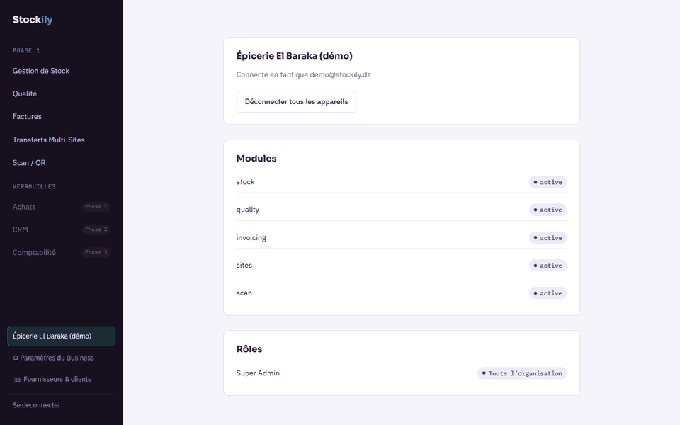

> Every screenshot below is captured from the real running app (NestJS API + Vite web app + PostgreSQL) loaded with the repo's own demo seed (`npm run db:seed:demo`), plus the design docs in `docs/`.

## Features

Phase 1 ships five modules, each gated by a per-organization entitlement (15-day trial on signup):

- **Stock**: products and categories, append-only stock movements (receipt, sale, adjustment, transfer), weighted average cost, low-stock thresholds, per-batch remaining quantities derived from the ledger, quantities capped at available stock. Live updates over Socket.IO.
- **Multi-site**: several warehouses or points of sale per organization, inter-site transfers with driver info. Stock moves when the transfer is delivered, not when it is created.
- **Quality**: batches and lots, quality checks, non-conformities that quarantine stock, a scheduled expiry sweep that raises near-expiry alerts, and a resolve flow for quarantined lots.
- **Invoicing**: gapless per-organization invoice numbering, multi-line invoices with tax rates, a partner directory (clients and suppliers, NIF), flexible payments (partial, mark-paid, undo), overdue reminder emails (SMTP or a logging no-op), amount in words in French and Arabic, PDF generation.
- **Scan**: barcode/QR labels with printable label PDFs, scan-to-resolve a product or lot, and a "Vente rapide" retail-till mode (cart, paid or unpaid on the spot). Camera scanning uses `BarcodeDetector` with a manual / USB-scanner fallback; a mobile home screen is included.
- **Platform**: signup/login with short-lived JWT access tokens and rotating refresh tokens (logout, logout-everywhere, silent refresh on the client), roles and permissions, an audit log written by an interceptor on mutating endpoints, org legal profile and logo.
- **Hardening**: CORS allowlist, `helmet`, rate limiting (stricter on auth), a global exception filter that does not leak internals, queries scoped by `orgId`, and a Docker `HEALTHCHECK` backed by a real Postgres round-trip (`GET /health`).

## Screenshots

| Stock | Quality |
| --- | --- |
| 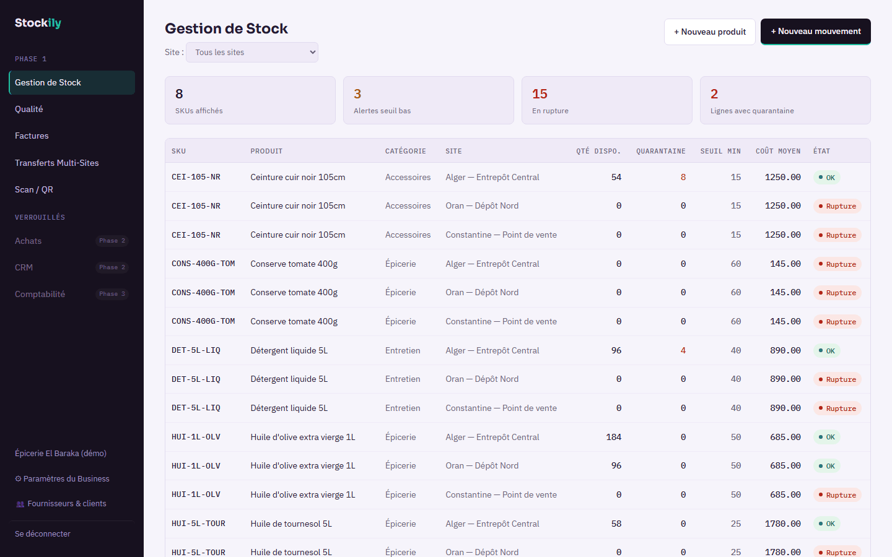 | 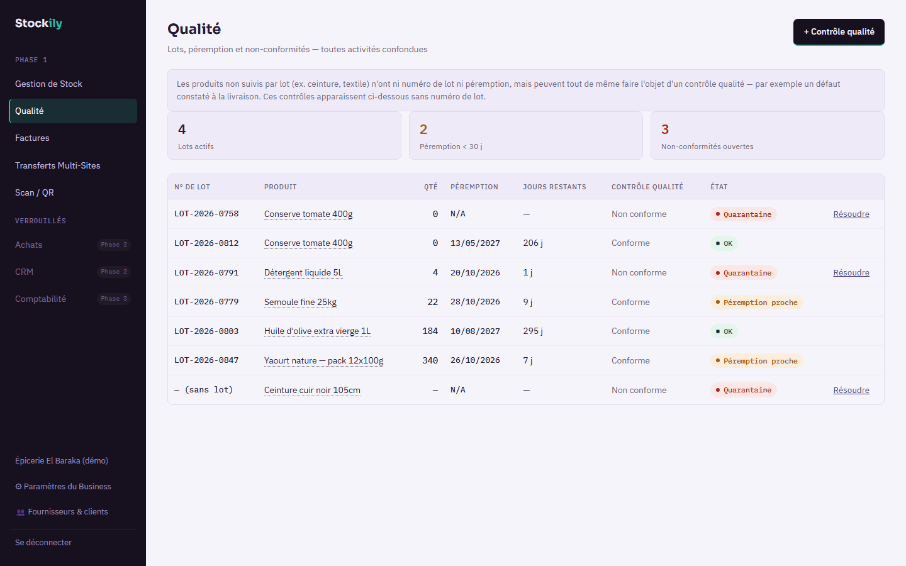 |

| Invoicing | Invoice detail (FR + AR amount in words) |
| --- | --- |
| 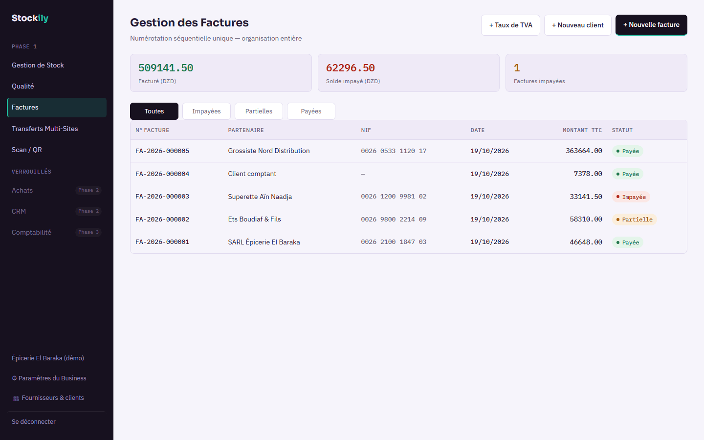 | 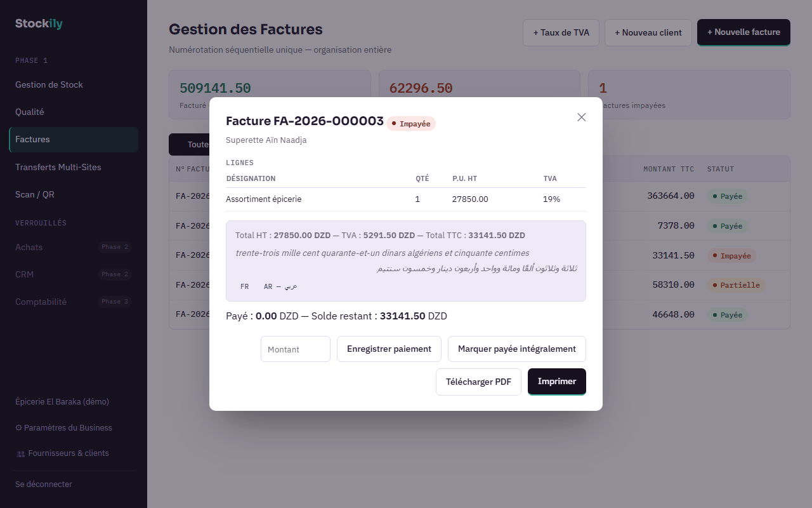 |

| Multi-site | Scan: quick sale |
| --- | --- |
| 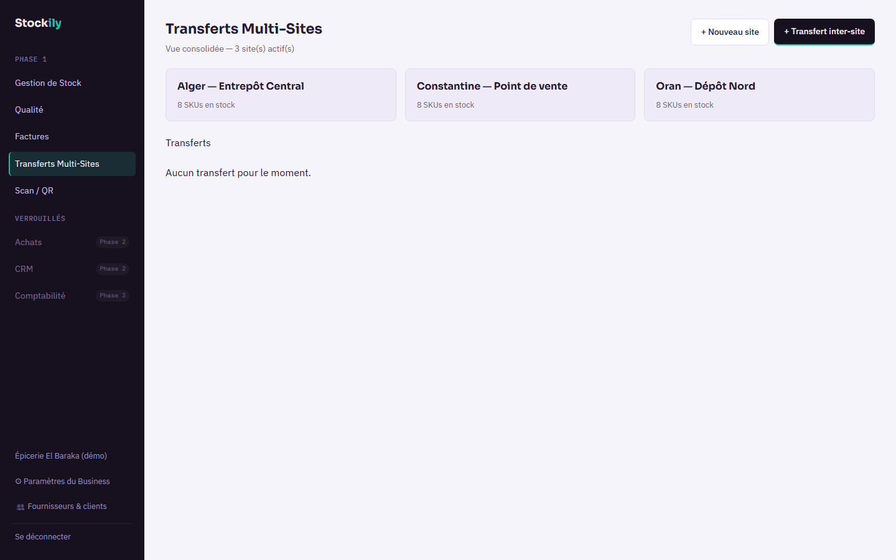 | 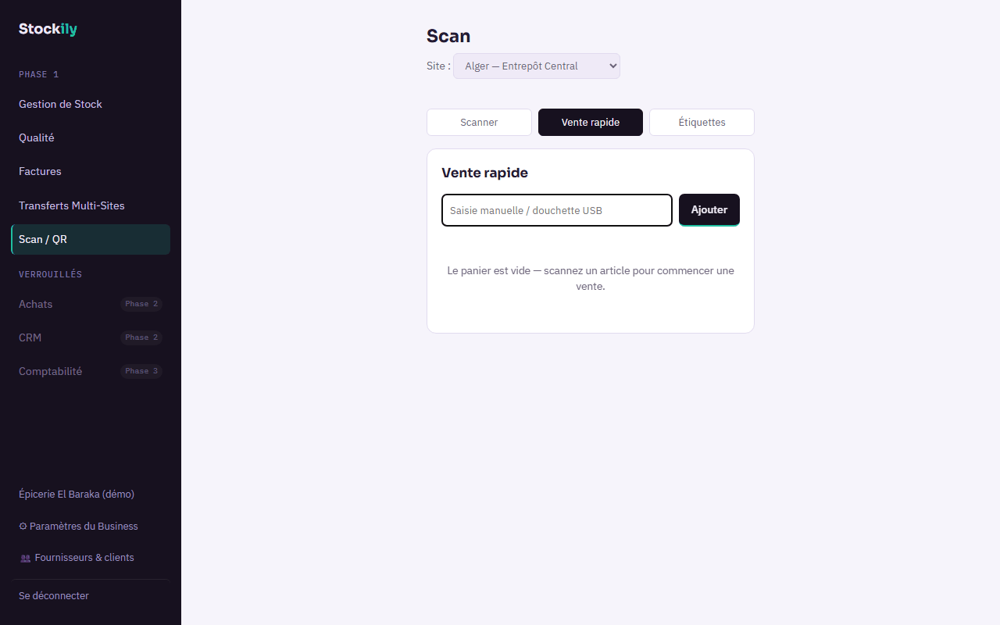 |

| Partners directory | Mobile home |
| --- | --- |
| 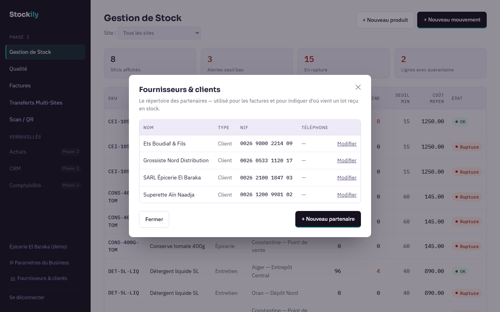 | 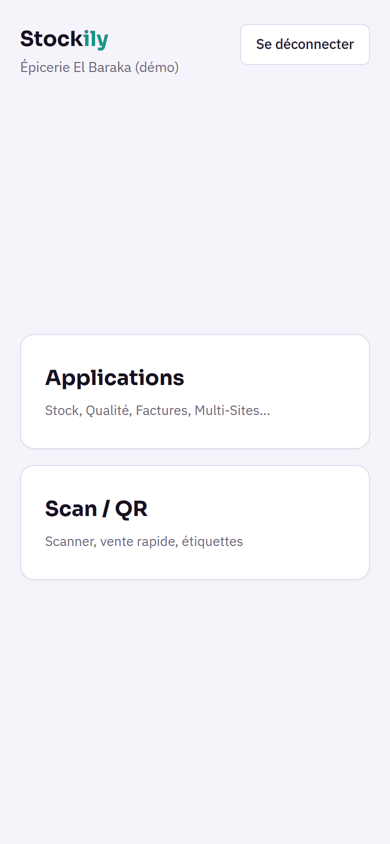 |

### Design docs

The product was designed before it was built. The high-fidelity wireframes, brand system and pricing grid live in [`docs/`](docs) as standalone HTML, and the real app was built to match them.

| Wireframe (design) | Brand system |
| --- | --- |
| 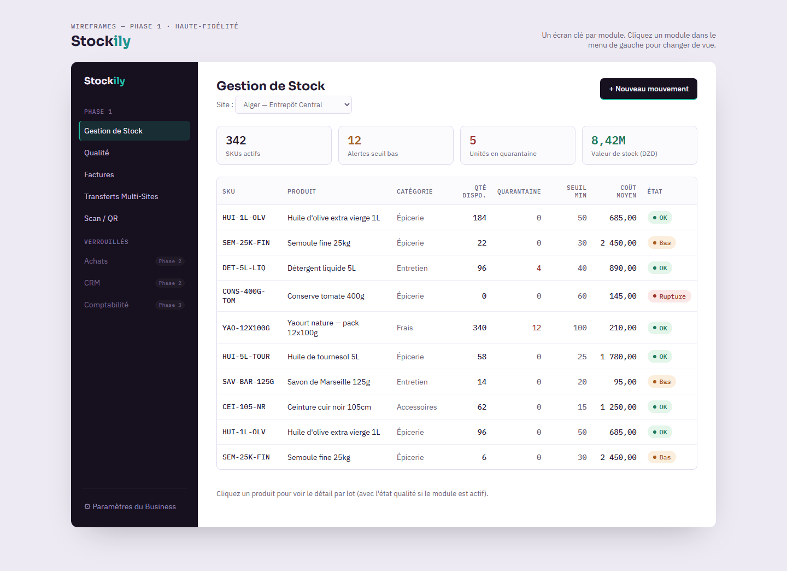 | 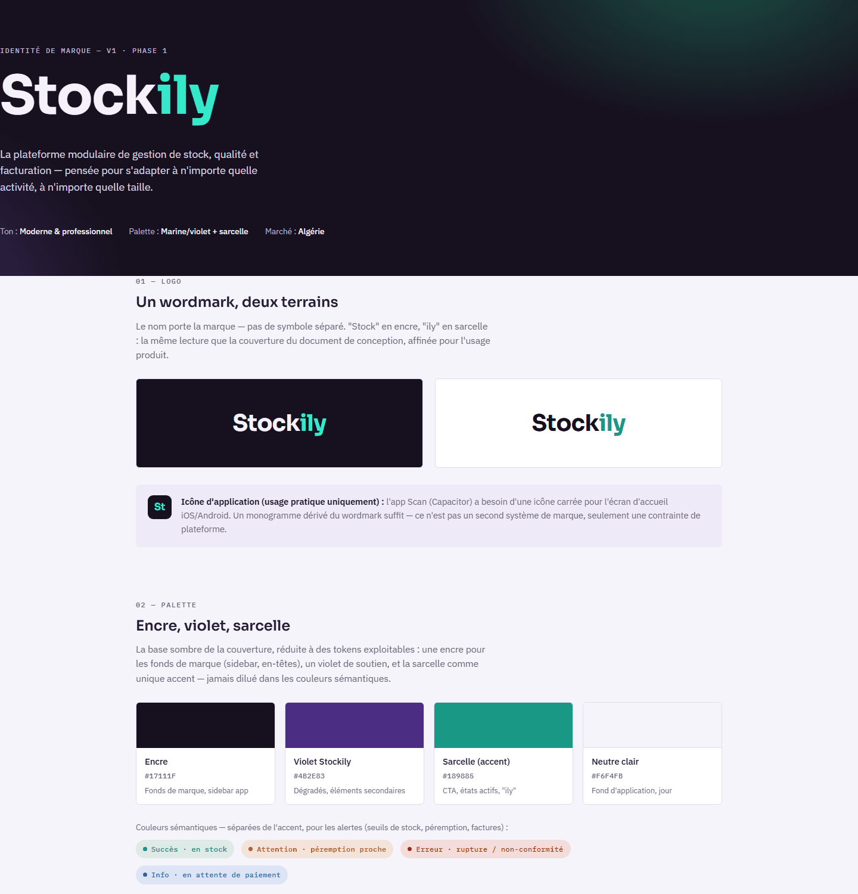 |

## Architecture

The core idea is hexagonal modularity. Business logic lives in framework-agnostic `domain-*` packages that talk to the outside world only through ports. Prisma adapters implement those ports in `infra-db`, and NestJS controllers are a thin HTTP shell. The rule is enforced by ESLint (`no-restricted-imports` and `@nx/enforce-module-boundaries`), not just by convention, which keeps a future local/offline mode possible.

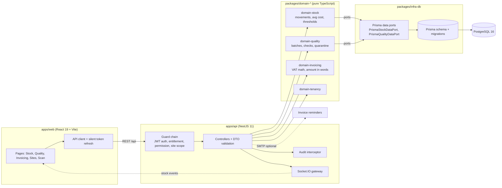

### Data model (simplified)

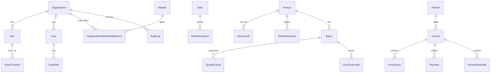

The full schema (26 models) is in [`packages/infra-db/prisma/schema.prisma`](packages/infra-db/prisma/schema.prisma).

## Tech stack

| Layer | Tools |
| --- | --- |
| Monorepo | Nx 23, module-boundary lint rules |
| Backend | NestJS 11, Socket.IO, class-validator, pdfkit, nodemailer, bcryptjs, helmet, @nestjs/throttler |
| Frontend | React 19, React Router 7, Vite 8 |
| Data | PostgreSQL 16, Prisma 6 (migrations and seeds) |
| Testing | Jest (api, plus e2e specs against a real Postgres), Vitest |
| DevOps | Docker Compose (Postgres, api, web on nginx), GitHub Actions CI (lint, build, test) |

## Getting started

Prerequisites: Node 22+ and Docker (for Postgres).

```bash
docker compose up -d postgres        # Postgres on localhost:5432
npm install
cp .env.example .env                 # dev defaults; set a real JWT_SECRET for anything else
npm run prisma:migrate               # create the schema
npm run db:seed                      # module registry + system roles
npm run db:seed:demo                 # demo organization with sample data
npx nx serve api                     # http://localhost:3000/api
npx nx serve web                     # http://localhost:4200
```

Log in with the demo account created by `db:seed:demo`: `demo@stockily.dz` / `Demo1234!`. Or sign up at `/signup` to create a fresh organization.

Useful commands: `npx nx run-many -t lint build test`, `npx nx graph` (project dependency graph), `npm run test:e2e:db:setup` (test database for the e2e specs). Secondary-database migrations, the production checklist (secrets, CORS, SMTP, TLS) and the Postgres RLS discussion are in [`docs/OPERATIONS.md`](docs/OPERATIONS.md).

## Project structure

```
apps/
  api/                 NestJS backend: auth, tenancy guards, stock, sites, quality, invoicing, scan, realtime, audit
  web/                 React (Vite) frontend
packages/
  domain-stock/        movement service, average cost, thresholds (framework-agnostic)
  domain-quality/      batches, checks, quarantine, expiry logic
  domain-invoicing/    VAT math, amount in words (FR/AR)
  domain-tenancy/      tenancy primitives
  shared-types/        contract types shared by api and web
  shared-ui/           shared React components
  infra-db/            Prisma schema, migrations, seeds, port implementations
docs/                  Action Plan, 7 milestone logs, wireframes, brand system, pricing grid, operations notes
```

## Project history and notes

The repo keeps its real history (53 commits over about three days). Each `docs/MILESTONE_*.md` file is the build log for one unit of work: what was built, the decisions behind it, and how to verify it. Milestone 7 documents the bug-fix round found by using the app as a real wholesaler.

- **Done:** auth and tenancy, Stock, Multi-site, Quality, Invoicing, Scan, the hardening pass, the mobile home and Scan experience.
- **Not done (deliberately):** Postgres row-level security. Tenant isolation currently relies on `orgId` scoping in every query; the RLS design and the risks of rushing it are written up in `docs/OPERATIONS.md`.
- **Roadmap:** Phase 2 modules (Purchasing, CRM) and Phase 3 (Accounting) appear locked in the UI. A local/offline mode is the reason the domain layer is kept framework-free.
- **Known quirk:** `@org/api:typecheck` reports four errors in the e2e specs' dynamic `import()` (a tsconfig project-reference issue, documented in Milestone 7).
- The UI copy is French (the target market); code and most docs are English or French.

## Author

**Hannoun Amine Amar**, AI Engineer / Fullstack Developer, Algeria.
[LinkedIn](https://www.linkedin.com/in/hannoun-amine/) | hannoun.amine25@gmail.com

Licensed under the [MIT License](LICENSE).
